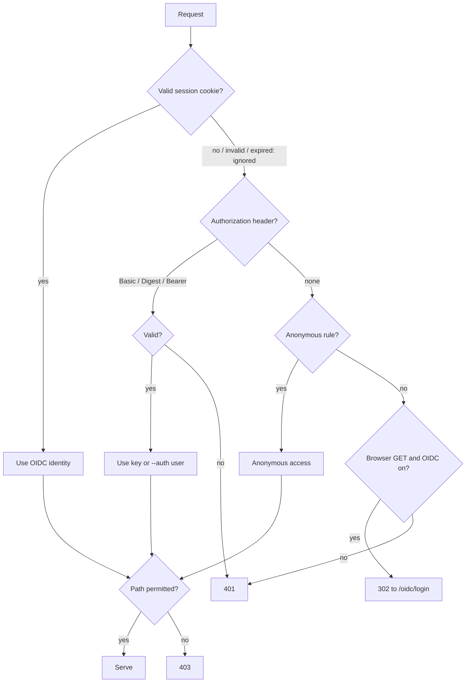

# OIDC login and API keys

This fork adds two opt-in auth mechanisms next to upstream `--auth`:

- `oidc:` lets people sign in through an OpenID Connect provider (Keycloak) in the browser. Permissions come from claims in the ID token.
- `api_keys:` gives machines named tokens, sent as `Authorization: Basic name:token` or `Bearer token`.

Both are top-level blocks in the YAML config. See [`config.example.yaml`](../config.example.yaml) for a complete file.

> The top-level `auth:` key is still the legacy rule list (`user:pass@/path:perm`). It is not related to `oidc` or `api_keys`.

If none of `--auth`, `oidc.enabled` or `api_keys` is set, dufs behaves as upstream (open). If any is set, everything is protected; anonymous access exists only through an `--auth @/path` rule.

## Quick start

1. Start the dev Keycloak: `docker compose -f dev/keycloak/docker-compose.yml up -d` (see [dev/keycloak](../../dev/keycloak/README.md)).
2. Copy `config.example.yaml`, set the `CHANGE-ME` values.
3. Run `dufs --config config.yaml`.
4. Open `http://localhost:5000`. You are redirected to Keycloak; sign in as `alice` / `alice`.

> **Write access needs two things.** A `:rw` path in `oidc.rules` or `api_keys` grants the permission, but the server must also allow writes: set `allow-all: true` (or `allow-upload`, `allow-delete`, ...) in the config or pass `-A`. Without it the Upload / New folder / New file buttons are hidden and writes return 403 even for `:rw` users.

## Config reference

### `oidc`

| Key              | Default                    | Description                                                                                                                                                      |
| ---------------- | -------------------------- | ---------------------------------------------------------------------------------------------------------------------------------------------------------------- |
| `enabled`        | `false`                    | Turn OIDC on. Other keys are validated only when `true`.                                                                                                         |
| `issuer`         | required                   | Issuer URL, for example `http://localhost:8080/realms/dufs`. Discovery is lazy: dufs starts even if the IdP is down; login returns 503 until discovery succeeds. |
| `client_id`      | required                   | Confidential client id.                                                                                                                                          |
| `client_secret`  | required                   | Client secret. Never logged.                                                                                                                                     |
| `redirect_url`   | required                   | Full callback URL, ending in `/oidc/callback` (with `--path-prefix`, include the prefix). `https` makes cookies `Secure`.                                        |
| `scopes`         | `[openid, profile, email]` | Scopes requested.                                                                                                                                                |
| `session_secret` | required                   | At least 32 bytes. Signs cookies and download tokens.                                                                                                            |
| `session_ttl`    | `8h`                       | Seconds (`3600`) or a number with `s`, `m`, `h` or `d` (`30m`, `1d`).                                                                                            |
| `user_claim`     | `preferred_username`       | Claim for the user name; falls back to `email`, then `sub`.                                                                                                      |
| `rules`          | `[]`                       | Claim-to-permission rules, below.                                                                                                                                |
| `default_paths`  | `[]`                       | Paths for logged-in users matching no rule. Empty means 403. Never applies to anonymous visitors.                                                                |

Snake_case keys are primary; kebab-case aliases (`client-id`, `session-secret`, ...) are accepted.

### `oidc.rules`

```yaml
rules:
  - claim: groups
    contains: /devops
    paths: ["/releases:rw", "/docs:ro"]
```

- `claim` is a dotted path into the ID token JSON: `groups`, `realm_access.roles`.
- `equals` compares a string claim (or the claim as a single string).
- `contains` matches an element of an array claim, or an exact string for a scalar claim. There is no substring matching.
- Values compare verbatim, so Keycloak group paths keep the leading `/` (`/devops`).
- `paths` uses the `--auth` syntax, `/path:perm` with `ro` or `rw`, one entry per path.
- Rules are evaluated on every request from the session cookie; all matching rules are merged and the widest permission per path wins. Editing rules applies immediately; group changes at the IdP apply at next login (bounded by `session_ttl`).
- The cookie stores only claim values that some rule references. Login fails with an error page if the signed cookie would exceed 3.5 KB.

### `api_keys`

| Key     | Description                                                                                        |
| ------- | -------------------------------------------------------------------------------------------------- |
| `name`  | Unique, non-empty, must not collide with an `--auth` user. Used as the Basic username and in logs. |
| `token` | Secret, in one of the formats below. `key` is accepted as an alias.                                |
| `paths` | List of `/path:perm`.                                                                              |

## Token formats

| Format        | Example        | Basic | Bearer |
| ------------- | -------------- | ----- | ------ |
| Plain         | `s3cret-token` | yes   | yes    |
| SHA-256       | `sha256:<hex>` | yes   | yes    |
| SHA-512 crypt | `$6$salt$hash` | yes   | no     |

Plain tokens are readable in the config file and trigger a startup warning; prefer a hashed form.

```bash
TOKEN=$(openssl rand -hex 32)                     # the secret you give to the client
printf %s "$TOKEN" | sha256sum | cut -d' ' -f1   # put after "sha256:" in the config
openssl passwd -6 "$TOKEN"                        # or use this $6$ hash (Basic only)
```

Use `printf %s`, not `echo`: a trailing newline changes the hash.

## Using an API key

```bash
# Basic: username is the key name
curl -u ci-plain:"$TOKEN" https://files.example.com/releases/app.apk -o app.apk

# Bearer: plain and sha256 keys only
curl -H "Authorization: Bearer $TOKEN" -T app.apk https://files.example.com/releases/app.apk
```

A `$6$` key used with Bearer is rejected (401). API keys can also call `?tokengen` for download links.

## Identity precedence



The diagram shows how a request resolves to an identity. A present but wrong `Authorization` header is always 401 and never falls back to anonymous; 403 means a valid identity without permission on the path.

## Routes and the reserved name

| Route                          | Purpose                                                                                                |
| ------------------------------ | ------------------------------------------------------------------------------------------------------ |
| `GET /oidc/login?return=/path` | Start login (state, nonce, PKCE S256). `return` must be a same-origin path; anything else becomes `/`. |
| `GET /oidc/callback`           | IdP redirect target; sets the session cookie.                                                          |
| `GET /oidc/logout`             | Clears the cookies. Does not end the IdP session.                                                      |

All are prefixed by `--path-prefix`. While `oidc.enabled` is true, the top-level name `oidc` is reserved: hidden from listings, 404 for other `/oidc/*` paths, and 403 for upload, mkdir, new file, move or copy targeting it. Existing deployments with an `oidc` folder are unaffected until they enable OIDC; dufs warns at startup if one exists.

## Cookies and CSRF

- Cookie `dufs_session` is `HttpOnly; SameSite=Lax; Path=/`, plus `Secure` when `redirect_url` is https.
- Sessions are stateless, HMAC-SHA256 signed with `session_secret`. There is no server store; changing `session_secret` logs everyone out.
- `SameSite=Lax` blocks cross-site POST/PUT/DELETE with the cookie. Terminate TLS in front of dufs and use an https `redirect_url` in production.
- Secrets, tokens and cookies are never written to logs; the log shows the user name only.

## Download tokens

`?tokengen` works for OIDC sessions and API keys, and `?token=` downloads work without a cookie. The token embeds the user and resolved paths, is path-bound, valid for 3 days, and signed with a key derived from `session_secret` (for API keys, from the key's own token). Rotating `session_secret` invalidates outstanding OIDC download tokens.

## Register the redirect URI in Keycloak

1. Clients, then `dufs`, then Settings.
2. Client authentication: on. Standard flow: on; other flows off.
3. Valid redirect URIs: the exact `redirect_url`, for example `https://files.example.com/oidc/callback`.
4. Advanced, then Proof Key for Code Exchange Method: `S256`.
5. Add a Group Membership mapper (token claim name `groups`, Full group path on, Add to ID token on) if rules use groups.

## Migration from `--auth`

`--auth user:pass@/path:perm` and the YAML `auth:` list keep working unchanged, including Digest and `$6$` passwords. Prefer `api_keys` for machines: named, hashable, and usable as Bearer. Move a rule by creating an `api_keys` entry with the same paths and switching clients from `user:pass` to `name:token`, then remove the `--auth` rule. Key names must not equal an `--auth` user.

## Related

- [Example config](../config.example.yaml) — every key with comments
- [Keycloak dev harness](../../dev/keycloak/README.md) — local IdP with users `alice` and `bob`
- [Upstream README](../README.md) — `--auth` syntax and other dufs options
